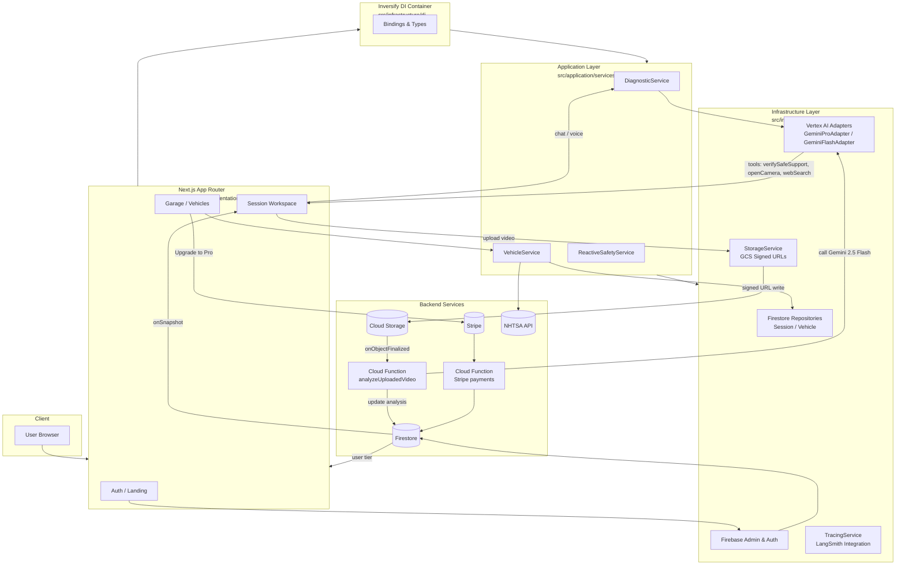
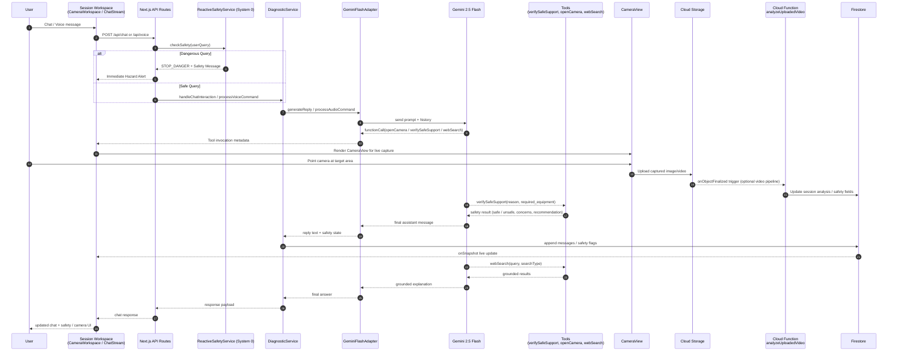

# Lemonade MVP

AI-powered vehicle diagnostic platform. A "Master Technician" in your pocket.

# CONFIDENTIAL - PROPRIETARY SOFTWARE

## Overview

Lemonade provides accurate, safe, and instant mechanical diagnostics via video and chat. The platform utilizes a sophisticated **Neuro-symbolic 4-Layered Architecture** (System 2) combined with **Reactive Safety Gating** (System 0) to ensure grounded reasoning and absolute user safety.

**Core Philosophy**: Safety First, Accuracy Second, Speed Third.

## Tech Stack

| Layer      | Technology                          |
| ---------- | ----------------------------------- |
| Framework  | Next.js 15 (App Router)             |
| Language   | TypeScript (Strict Mode)            |
| Database   | Firebase Firestore                  |
| Auth       | Firebase Authentication (Google)    |
| Storage    | Google Cloud Storage                |
| AI         | Google Vertex AI (Gemini 2.5 Flash), Context Caching |
| Real-Time  | LiveKit (WebRTC)                    |
| Mobile     | React Native (Expo) + WebView Hybrid|
| Deployment | Google Cloud Run                    |

## Prerequisites

- Node.js 20+
- npm 10+
- Google Cloud Project with:
  - Vertex AI API enabled
  - Firebase project configured
  - Cloud Storage bucket
- Firebase Service Account Key (JSON)

## Environment Setup

Create `.env.local` in the project root:

```env
# Firebase Client
NEXT_PUBLIC_FIREBASE_API_KEY=your_api_key
NEXT_PUBLIC_FIREBASE_AUTH_DOMAIN=your_project.firebaseapp.com
NEXT_PUBLIC_FIREBASE_PROJECT_ID=your_project_id
NEXT_PUBLIC_FIREBASE_STORAGE_BUCKET=your_project.firebasestorage.app
NEXT_PUBLIC_FIREBASE_MESSAGING_SENDER_ID=your_sender_id
NEXT_PUBLIC_FIREBASE_APP_ID=your_app_id

# Firebase Admin (Server)
FIREBASE_SERVICE_ACCOUNT_KEY={"type":"service_account",...}

# Google Cloud
GCLOUD_PROJECT=your_project_id
GCLOUD_MEDIA_BUCKET=your_bucket.firebasestorage.app

# Stripe (Payments)
NEXT_PUBLIC_STRIPE_PUBLISHABLE_KEY=pk_test_...
STRIPE_SECRET_KEY=sk_test_...

# LangSmith (AI Observability)
LANGCHAIN_TRACING_V2=true
LANGCHAIN_API_KEY=your_langsmith_key
LANGCHAIN_PROJECT=lemonade-master-tech
```

## Installation

```bash
# Install dependencies
npm install

# Install Firebase Functions dependencies
cd functions && npm install && cd ..
```

## Development

```bash
# Start development server
npm run dev

# Run linting
npm run lint

# Run tests
npx vitest run

# Build for production
npm run build

# Start Mobile App
cd mobile
npx expo start

```

## Project Structure

```
packages/
├── core/                 # Pure domain logic (entities, interfaces, types)
└── infrastructure/       # Shared adapters (AI, Firebase, Logging)
src/
├── app/                  # Next.js App Router (API Routes & Pages)
├── application/          # Business logic orchestration
│   └── services/         # DiagnosticService, ReactiveSafetyService, etc.
├── infrastructure/       # Web-specific implementations & DI container
└── presentation/         # React UI layer (Components, Hooks)
mobile/                   # React Native Application (Expo)
├── app/                  # Native routing
├── components/           # Native UI components
└── infrastructure/       # Native hardware implementations
```

## Architecture

The application follows a strict layered architecture with InversifyJS for dependency injection:

1. **Core (`packages/core`)** → Pure domain logic and contracts, zero external dependencies.
2. **Infrastructure (`packages/infrastructure`)** → Shared adapters for external integrations (Firebase, Vertex AI, Tracing).
3. **Application (`src/application`)** → Business logic orchestration and neuro-symbolic reasoning.
4. **Presentation (`src/presentation`)** → React UI components and state management.
5. **Mobile (`mobile/`)** → Hybrid Architecture (Native Camera + Shared WebViews).

See `docs/LEMONADE-ARCHITECTURE.md` for detailed documentation.

### Hybrid Mobile Architecture

The mobile app follows a "Hybrid" approach to leverage the best of both worlds:
- **"Native" Zone (React Native)**: Critical real-time features like Camera, Microphone, and LiveKit video streams run natively for 60fps performance and raw hardware access.
- **"WebView" Zone (Next.js)**: Complex content like PDF Manuals, Chat History, and Billing are rendered in a shared Web View, allowing rapid iteration and reusing the robust web frontend.
- **The Bridge**: The user seamlessly toggles between "Live Mode" (Native) and "Chat Mode" (WebView).

### High-Level Architecture Diagram



### Tool-Calling & Camera Flow



### Neuro-symbolic Reasoning Loop (System 2)

Lemonade implements a "System 2" deliberate reasoning process to eliminate AI hallucinations and ensure safety:

1. **Node 1: Perception (Intuition)**: AI generates a hypothesis from visual/acoustic evidence.
2. **Node 2: Authority (The Law)**: NHTSA recall/TSB check overrides AI intuition for safety-critical issues.
3. **Node 3: Consensus (Collective Memory)**: Vector search of verified community fixes validates the repair pattern.
4. **Node 4: Reality Anchor (Grounding)**: Symbolic verification of specs (torque, fluid types) against extracted metadata and live visual state.

**Reactive Safety Gating (System 0)**: A deterministic layer that monitors user input for high-risk keywords (e.g., "gas leak", "orange cables") to trigger immediate safety stops before AI processing.

## Key Features

- **Neuro-symbolic Reasoning (System 2)**: A 4-node loop (Perception, Authority, Consensus, Reality Anchor) that validates AI intuition against technical manuals and physical reality.
- **Reactive Safety Gating (System 0)**: Deterministic, instant protection against critical hazards (fuel leaks, high voltage) bypassing deep reasoning for immediate response.
- **Agentic Custom Grounding**: Proprietary metadata extraction from TSBs, recalls, and technical documentation for precision diagnostic verification.
- **Real-time Chat** with Gemini 2.5 Flash and LangSmith observability.
- **Video Analysis** for high-fidelity visual diagnostics and physical state verification.
- **Voice Input** with VAD (Voice Activity Detection) for hands-free shop use.
- **Live Session Sync** via Firestore real-time listeners.
- **Robust Context Caching**: Caches Technical Service Manuals (PDFs) in Vertex AI for low-latency retrieval.
- **Hybrid Mobile Experience**: Native camera performance mixed with web-based rich content.

## Deployment

### Docker (Cloud Run)

```bash
# Build image
docker build -t lemonade-mvp .

# Run locally
docker run -p 3000:3000 --env-file .env.local lemonade-mvp
```

### Cloud Run Deployment

```bash
# Deploy to Cloud Run
gcloud run deploy lemonade-mvp \
  --image gcr.io/PROJECT_ID/lemonade-mvp \
  --platform managed \
  --region us-central1 \
  --allow-unauthenticated
```

## Firebase Setup

```bash
# Deploy Firestore rules
firebase deploy --only firestore:rules

# Deploy Storage rules
firebase deploy --only storage

# Deploy Cloud Functions
firebase deploy --only functions
```

## Testing

```bash
# Run all tests
npx vitest run

# Run specific test suite
npx vitest run src/core/tools/__tests__

# Run with coverage
npx vitest run --coverage

# E2E tests (Playwright)
npx playwright test
```

## API Routes

| Endpoint                | Method | Description                      |
| ----------------------- | ------ | -------------------------------- |
| `/api/chat`             | POST   | AI chat with web search          |
| `/api/vehicles/scan`    | POST   | VIN decode & vehicle onboarding  |
| `/api/upload/sign`      | POST   | Get signed URL for direct upload |
| `/api/analysis/trigger` | POST   | Trigger video analysis           |
| `/api/stripe/checkout`  | POST   | Create Stripe checkout session   |
| `/api/stripe/portal`    | POST   | Access billing portal            |

## Security

- All API routes protected by middleware authentication
- Firebase Auth tokens validated server-side
- Firestore security rules enforce user-level access
- Service account credentials never exposed to client

## Monitoring

- **LangSmith**: AI request tracing and safety evaluations
- **Firebase Console**: Firestore usage, Auth metrics
- **Cloud Run**: Request logs, error tracking

---

**© 2025 Lemonade. All Rights Reserved.**

This software is proprietary and confidential. Unauthorized copying, distribution, or use is strictly prohibited.
