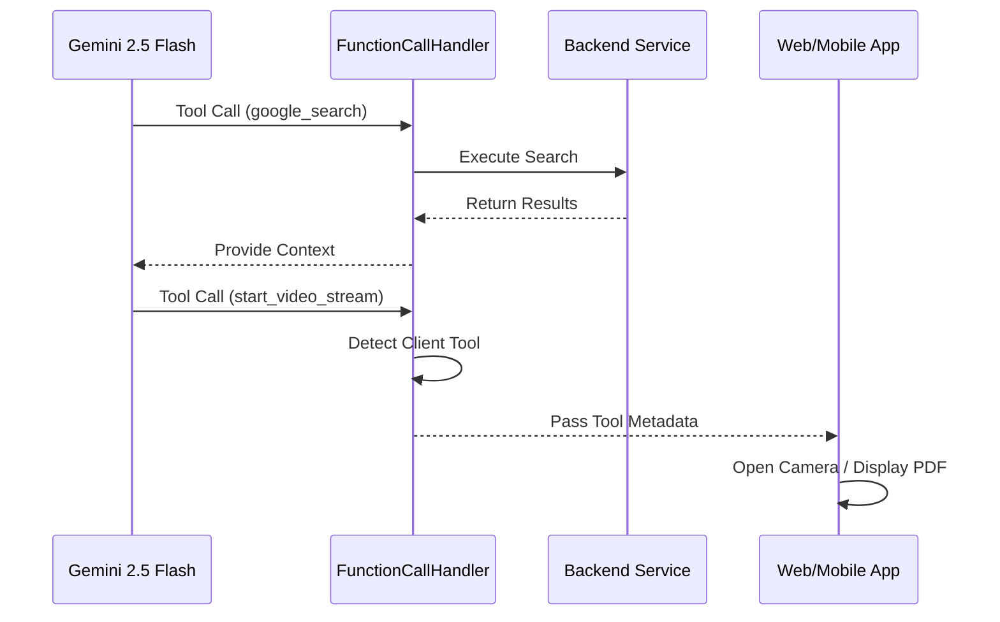
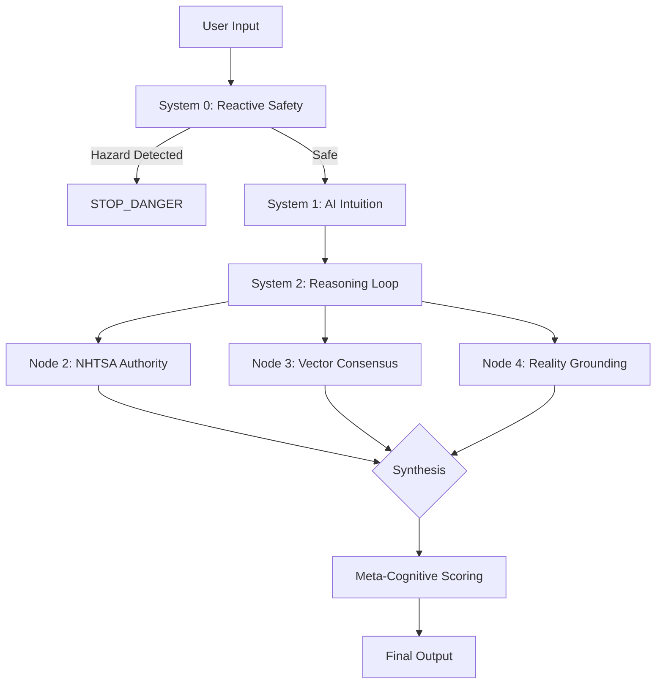

# Lemonade Platform Feature Map

This document provides a comprehensive overview of all features and capabilities within the Lemonade platform, categorized by interface, logical layer, and user goal.

---

## 1. Features by Interface
*Organized by how the user interacts with the platform.*

### 1.1 Chat Interface (Web & Mobile)
The primary interaction model for "System 2" deliberate reasoning.

#### **A. Expert Diagnostic Chat**
- **User Story:** As a mobile mechanic, I want to describe a vehicle's symptoms (e.g., "rough idle on cold start") so that I can receive a list of prioritized diagnostic steps and possible causes.
- **Master Tech Scenario:** A technician describes a misfire on a 2015 Camry. The AI identifies that this specific model often has ignition coil failures and recommends swapping Coil #1 with Coil #2 to verify before buying parts.
- **Technical "Under the Hood":**
    - Uses `ChatService` to orchestrate interactions.
    - Powered by `GeminiFlashChatAndUploadsAdapter` (Gemini 2.5 Flash).
    - Integrates `ComplaintIdentificationService` to automatically extract the core issue from conversation history.
    - Utilizes `SummarizationService` for context window management by summarizing long history segments.
- **Status:** `Active`

#### **B. Multimodal Symptom Analysis (Image/Video Upload)**
- **User Story:** As a shop technician, I want to upload a high-resolution photo of a worn component so that the AI can identify wear patterns and verify if the part is OEM or aftermarket.
- **Master Tech Scenario:** A user uploads a video of a ticking engine. The AI analyzes the acoustic frequency and visual movement of the drive belt to determine if the noise is a bad lifter (internal engine) or a failing alternator pulley (external).
- **Technical "Under the Hood":**
    - Uses `VideoAnalysisService` for processing static media.
    - `analyzeUploadedImage` and `analyzeUploadedVideo` in `GeminiFlashChatAndUploadsAdapter`.
    - Returns structured `AIAnalysis` including severity and suggested actions.
- **Status:** `Active`

#### **C. Technical Reference Retrieval**
- **User Story:** As a technician, I want to ask for the torque specifications for a specific cylinder head so that I can ensure a safe and correct installation without searching through a 1000-page PDF manually.
- **Master Tech Scenario:** A technician asks for "2018 Ford F-150 wheel lug nut torque." The AI uses `google_search` to verify if there's a TSB that updated the spec from the original factory manual.
- **Technical "Under the Hood":**
    - `google_search` tool for real-time TSB and spec grounding.
    - `consult_manual` (Experimental) for RAG-based search within uploaded documentation.
- **Status:** `Active` (Web Search) / `Experimental` (Manual Search)

### 1.2 Live Mode (Mobile & LiveKit)
Real-time, high-performance interaction for hands-on work.

#### **A. 60FPS Live Video Diagnostics**
- **User Story:** As a mechanic working under the hood, I want to point my camera at a running engine so the AI can "listen" to the knock and "see" the vibration in real-time.
- **Technical "Under the Hood":**
    - Built on **LiveKit WebRTC** for low-latency streaming.
    - `GeminiFlashLiveStreamAdapter` processes frames and audio chunks.
    - Uses `useCameraVisionStream` hook for native performance on iOS/Android.
- **Status:** `Active`

#### **B. Voice-First Hands-Free Guidance**
- **User Story:** As a technician with greasy hands, I want to ask the AI to "Check the fuse map for the fuel pump" while I'm looking at the fuse box, without touching my phone.
- **Technical "Under the Hood":**
    - Integrated VAD (Voice Activity Detection) via Silero.
    - Real-time TTS (Text-to-Speech) for audible instructions.
- **Status:** `Active`

#### **C. Local Perception Triage (SmolVLM2)**
- **User Story:** As a technician in a shop with poor Wi-Fi, I want my phone to instantly identify the vehicle's engine components locally so that the cloud AI can focus on deep reasoning rather than basic identification.
- **The "Scout & Surgeon" Model:**
    - **SmolVLM2 (The Scout):** Runs locally on-device. It performs constant, high-speed identification of components (e.g., "Alternator", "Drive Belt") and basic anomaly detection.
    - **Gemini 2.5 Flash (The Surgeon):** Receives the high-resolution frames *and* the metadata tags from SmolVLM2. It uses Smol's local detections as "ground truth" to perform deep mechanical reasoning and final diagnostics.
- **Technical "Under the Hood":**
    - Powered by **SmolVLM2-2.2B-Instruct** running via a local GGUF engine.
    - High-confidence detections are passed as `localTriage` context to Gemini, reducing "perception latency" and increasing diagnostic precision.
- **Status:** `Active`

### 1.3 Garage & Vehicle Management
The digital workspace for the technician's fleet.

#### **A. VIN-Based Vehicle Onboarding**
- **User Story:** As a mobile mechanic, I want to enter or scan a VIN so that the correct engine, transmission, and recall data are instantly available for the diagnostic session.
- **Technical "Under the Hood":**
    - `VehicleService.onboardVehicle()` orchestrates the creation.
    - Uses `NHTSAVehicleInfoProvider` to decode the VIN into detailed specs (Year, Make, Model, Engine).
    - Persists vehicle metadata in Firestore.
- **Status:** `Active`

#### **B. Diagnostic History (The Medical Chart)**
- **User Story:** As a technician, I want to see all previous diagnoses for a specific vehicle so that I can track recurring issues and verify past repairs.
- **Technical "Under the Hood":**
    - `VehicleService.getHistory()` retrieves all linked `DiagnosticSession` records.
    - Integrated into the Garage UI (`src/app/garage/page.tsx`).
- **Status:** `Active`

#### **C. Multi-Vehicle "Garage" View**
- **User Story:** As a shop owner, I want a single dashboard where I can see every vehicle I'm currently working on and their active diagnostic status.
- **Technical "Under the Hood":**
    - Reactive Firestore collection listeners populate the garage list.
    - Shows `activeIssuesCount` per vehicle for quick triage.
- **Status:** `Active`

### 1.4 Billing & Subscription Management
The commercial engine of the platform.

#### **A. Tiered Feature Gating**
- **User Story:** As a free user, I want to use basic chat diagnostics, but I understand that advanced video analysis and multi-modal live mode require a "Pro" subscription.
- **Technical "Under the Hood":**
    - `BillingService.ts` checks user tier before sensitive AI calls.
    - Integrated with **Stripe** for subscription lifecycle.
- **Status:** `Active`

#### **B. Real-Time Token Usage Tracking**
- **User Story:** As a professional user, I want to see my diagnostic usage for the month so I can track my ROI.
- **Technical "Under the Hood":**
    - `BillingFirestoreRepository` records input/output tokens for every Gemini interaction.
- **Status:** `Active`

### 1.5 User Preferences & Personalization
- **Auto-Open Camera:** Configuration to skip confirmation dialogs for tool calls.
- **Diagnostic History:** Full searchable archive of all previous vehicle sessions.
- **Status:** `Active`

---

## 2. Features by Logical Layer
*Organized by the Neuro-symbolic architecture layers.*

### 2.1 System 0: Reactive Safety Layer
The first line of defense. Runs locally or at the edge of the API to provide instant deterministic protection.

#### **A. Hazard Keyword Gating**
- **Logic:** Uses high-fidelity regex matching to detect critical hazards (e.g., fuel leaks, battery smoke, orange cables).
- **Service:** `ReactiveSafetyService.ts`
- **Impact:** Bypasses AI reasoning entirely to return a `STOP_DANGER` verdict in <50ms.
- **Status:** `Active`

### 2.2 System 1: Heuristic Perception Layer
The "Intuition" node. Handles the initial processing of visual and acoustic signals.

#### **A. Local Perception (SmolVLM2)**
- **Role:** Constant identification and triage.
- **Logic:** Identifies "What am I looking at?" locally on the device.
- **Impact:** Provides instant feedback to the user and foundational context to the cloud reasoning layer.

#### **B. Cloud Perception (Gemini 2.5 Flash)**
- **Role:** High-fidelity evidence extraction.
- **Logic:** Identifies "What is wrong with this part?" using high-res imagery and temporal video analysis.
- **Impact:** Populates the `visual_evidence` and `acoustic_evidence` arrays used by System 2.

### 2.3 System 2: Deliberate Reasoning Layer
The core "Brain." Orchestrates specialized nodes to challenge intuition and verify solutions.

#### **A. Node 2: Authority (The Law)**
- **Logic:** Absolute override. If a federal recall exists for the vehicle/component, it terminates all other reasoning.
- **Service:** `NHTSAService.ts`
- **Impact:** Prevents the AI from suggesting a repair for a part that should be replaced for free by a dealer.
- **Status:** `Active`

#### **B. Node 3: Consensus (Collective Memory)**
- **Logic:** Vector search of verified historical fixes to identify patterns the manual might miss.
- **Service:** `VectorRepository.ts`
- **Output:** Identifies "Top Resolved Fixes" from the technician community.
- **Status:** `Active`

#### **C. Node 4: Reality Anchor (Grounding)**
- **Logic:** Cross-references technical specs (torque, fluid types) against extracted manual metadata and visual evidence.
- **Service:** `MechanicReasoningService.ts`
- **Conflict Resolution Flow:**
    1.  AI Hypothesis says "Component X is failing."
    2.  Grounding checks manual: "Component X requires Torque Y."
    3.  Vision check: "User has modified Component Z instead."
    4.  Logic: Reality trumps Manual. AI updates advice for modified part.
- **Status:** `Active`

### 2.4 Layer 4: External Verification Layer
The "Scientific Fact Checker."

#### **A. Real-Time Web Grounding**
- **Logic:** Activates `google_search` to find current TSBs or recall updates that contradict static manuals.
- **Tool:** `google_search`
- **Verification:** Explicit symbolic check (e.g., "Does result X confirm hypothesis Y?") before user output.
- **Status:** `Active`

### 2.5 Meta-Cognitive Layer
The self-correcting supervisor.

#### **A. Aggregate Confidence Scoring**
- **Logic:** Weighted algorithm that calculates a final `metaConfidence` score based on alignment between all layers.
- **Service:** `MechanicReasoningService.calculateMetaConfidence()`
- **Status:** `Active`

---

## 3. The Hierarchy of Truth
Lemonade follows a strict priority for resolving data conflicts:

1.  **SAFETY RECALL (NHTSA):** Absolute priority. Overrides all other data.
2.  **PHYSICAL REALITY (Vision):** Reality wins over the manual (e.g., if the car has a modified turbo, the OEM manual spec is ignored).
3.  **TSB/EXTERNAL DATA:** Updates from the web override static manual data.
4.  **SERVICE MANUAL:** Default source for specs and procedures.
5.  **COMMUNITY CONSENSUS:** Used to challenge or support the initial hypothesis.
6.  **AI INTUITION:** The baseline starting point, always subject to verification.


*Organized by the primary value provided to the technician.*

### 3.1 Diagnostic Troubleshooting
- **Dynamic Reasoning:** Combining visual cues with technical data to find the root cause.
- **Conflict Detection:** Identifying when "what the AI sees" contradicts "what the manual says."
- **Status:** `Active`

### 3.2 Technical Reference & Documentation
- **Instant TSB Access:** Finding Technical Service Bulletins in seconds.
- **Automated Recalls:** Immediate alerts if a part is under a federal safety recall via `NHTSAService`.
- **Status:** `Active`

### 3.3 Safety Compliance & Risk Mitigation
- **System 0 Hard-Stops:** Instant prevention of dangerous actions (Fuel leaks, High Voltage).
- **Jack Stand Verification:** AI-driven visual check before allowing undercarriage work.
- **Status:** `Active`

### 3.4 Professional Skill Development
- **"The Master Tech in your Pocket":** Providing ASE-certified level guidance to junior apprentices.
- **Reasoning Traces:** Explaining the "Why" behind every step to upskill the user.
- **Status:** `Active`

---

## 4. Agentic Tool Registry
*Technical specifications for all AI-invokable tools.*

### 4.1 `google_search`
- **Description:** Performs a Google Search to find real-world information, technical specs, or verify facts.
- **Orchestration:** Server-side loop in `FunctionCallHandler.ts`.
- **Zod Schema:**
  ```typescript
  z.object({ query: z.string() })
  ```
- **Returns:** Grounded search results with extracted publication dates.

### 4.2 `verify_safe_support`
- **Description:** Ensures vehicle is properly supported by jack stands.
- **Orchestration:** Backend-to-Frontend bridge. Triggers native camera view.
- **Zod Schema:**
  ```typescript
  z.object({ 
    reason: z.string(), 
    required_equipment: z.array(z.string()).optional() 
  })
  ```
- **Returns:** Visual confirmation of safety status.

### 4.3 `start_video_stream`
- **Description:** Requests high-resolution visual evidence of a specific component via 60FPS stream.
- **Orchestration:** Client-side tool call.
- **Zod Schema:**
  ```typescript
  z.object({
    reason: z.string(),
    targetComponent: z.string().optional(),
    focusArea: z.enum(['engine_bay', 'undercarriage', 'interior', 'exterior', 'specific_component'])
  })
  ```

### 4.4 `display_content`
- **Description:** Displays a specific diagram or manual page to the user.
- **Orchestration:** Client-side tool call intercepted by `useToolHandler.ts`.
- **Zod Schema:**
  ```typescript
  z.object({
    title: z.string(),
    url: z.string().url(),
    type: z.enum(['image', 'pdf', 'html'])
  })
  ```

### 4.5 `consult_manual` (Experimental)
- **Description:** Ask specific technical questions to uploaded vehicle documentation.
- **Orchestration:** Server-side RAG retrieval.
- **Zod Schema:**
  ```typescript
  z.object({ question: z.string() })
  ```

---

## 5. AI Model Registry
*The specialized models powering the platform's reasoning and perception.*

### 5.1 `gemini-2.5-flash`
- **Role:** Main multi-modal engine for chat, video analysis, and tool orchestration.
- **Strength:** High speed, large context window (1M+ tokens), and native tool-calling capabilities.

### 5.2 `gemini-live-2.5-flash-native-audio`
- **Role:** Real-time engine for Live Mode.
- **Strength:** Ultra-low latency audio/video processing for WebRTC integration.

### 5.3 `gemini-2.5-pro`
- **Role:** "System 2" deep reasoning (Thinking Budget mode).
- **Strength:** Used for high-complexity diagnostic scenarios where deep technical extraction is required.

### 5.4 `SmolVLM2-2.2B-Instruct`
- **Role:** On-device local perception.
- **Strength:** Runs locally on mobile hardware to provide instant visual feedback and triage without cloud latency.

### 5.5 `text-embedding-004`
- **Role:** Vector representation for community fixes.
- **Strength:** powers the Consensus Node (Node 3) by enabling semantic search across diagnostic history.

---

## 6. External Integrations

### 6.1 NHTSA API
- **Purpose:** VIN decoding and real-time safety recall checks.
- **Node:** Node 2 (Authority).

### 6.2 LiveKit (WebRTC)
- **Purpose:** Ultra-low latency video/audio streaming for hands-on diagnostics.
- **Modality:** Real-time multimodal analysis.

### 6.3 Stripe
- **Purpose:** Tiered access (Free vs. Pro) and billing management.
- **Features:** Diagnostic history and advanced video analysis are gated to Pro.

### 6.4 LangSmith
- **Purpose:** Full-trace observability for every reasoning step.
- **Feature:** Enables "Chain of Thought" auditing for technical fidelity.

---

## 7. Architectural Visuals

### 7.1 Tool Orchestration Loop


### 7.2 Neuro-symbolic Diagnosis Flow

