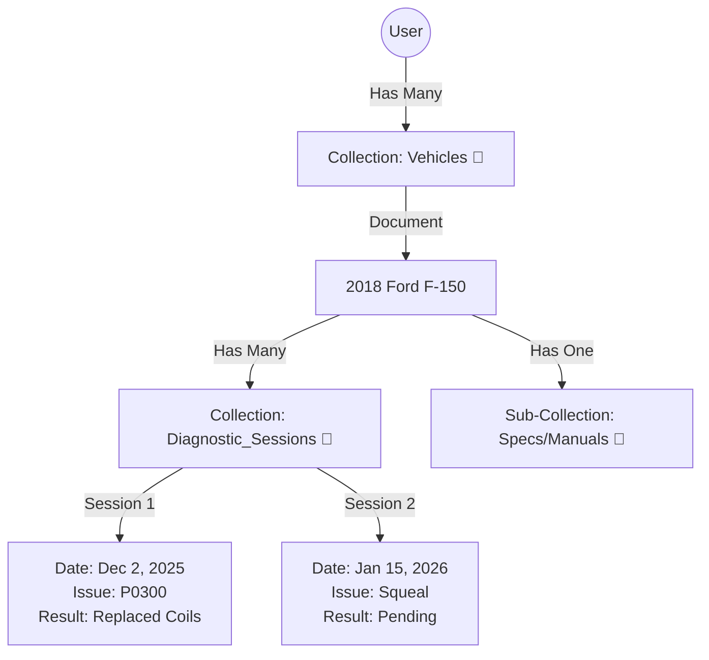

Designing for 500 active users is a "Goldilocks" zone. It is large enough to require a real, robust architecture, but small enough that we don't need to over-engineer it with complex microservices right away.

To prioritize system design effectively, we need to distinguish between Functional Requirements (what the app does) and Non-Functional Requirements (how the app behaves).

Here is a breakdown of what we need to get concrete before we draw any diagrams:

# 1. Functional Requirements (The "What")

These are the core behaviors. We need to know the specific data we are handling to choose the right database and backend structure.

| Requirement Type | Why it matters for System Design |
| :--- | :--- |
| **Core Interaction** | A chat app requires WebSockets, while a blog uses simple REST APIs. |
| **Data Model** | A social network needs a Graph DB, while a finance app needs a Relational DB. |
| **User Roles** | Admin dashboards often require separate internal APIs or security protocols. |

# 2. Non-Functional Requirements (The "How")

These are the constraints that shape our infrastructure choices.

*   **Read vs. Write Heavy**: Will users mostly consume content (like Twitter/X, which is 99% read) or generate content (like a logging tool or chat)? This decides if we need caching layers like Redis.
*   **Consistency vs. Availability**: If a user posts something, does everyone need to see it instantly (Consistency), or is a 5-second delay okay as long as the site never crashes (Availability)?
*   **Platform**: Are we building a Web App, Mobile App, or both? This affects API design.

## Guiding Questions

*   **The "One-Liner"**: In one sentence, what is the primary value this app provides to the user? (e.g., "It allows pet owners to book local walkers.")
*   **The Interaction Model**: Is this application Real-Time (e.g., chat, stock ticker) or Request-Response (e.g., e-commerce, to-do list)?
*   **Data Life Cycle**: Is the data highly transient (deleted after 24h) or permanent and critical (financial records)?

## Guiding Answers

*   **The "One-Liner"**: It allows users to query their car to diagnose issues. Whether that be P codes or if there are no codes available. While making sure to be safe and compliant and don't tell users to do harmful things.
*   **The Interaction Model**: Real-Time. Users would chat and the chat would have the capabilities to use their camera for real time video assistance.
*   **Data Life Cycle**: Permanent

# Here is how our Master Tech App answers each constraint.

## 1. Read vs. Write Heavy

**Verdict**: Our app is "Burst Write" / "Long Read."

*   **The Constraint**: During a 10-minute diagnostic session, the user is flooding the system with video chunks, audio, and text (Heavy Write). After the session, the data sits there for years and is only viewed occasionally (Low Read).
*   **The Design Choice**:
    *   **Firestore**: Excellent for this. It handles the "Burst" of writes easily without locking the database.
    *   **No Redis Yet**: Since we don't have millions of users reading the same viral post (like Twitter), we don't need a caching layer (Redis). Firestore's built-in caching is sufficient for the "Garage" view.

## 2. Consistency vs. Availability

**Verdict**: We prioritize Consistency (CP) for the active session.

*   **The Constraint**: If the AI shouts "STOP! The car is falling!", the user must see that message instantly. We cannot afford "Eventual Consistency" (a 5-second delay) in the chat.
*   **The Design Choice**:
    *   **Real-Time Listeners (onSnapshot)**: We use WebSockets (via Firebase SDK) to force the UI to update the millisecond the database changes. We do not use REST APIs (polling) for the chat.

## 3. Platform (Web vs. Mobile)

**Verdict**: Progressive Web App (PWA) First.

*   **The Constraint**: We want to scan VINs and record video, but we don't want to build two separate apps (iOS/Android) for the MVP.
*   **The Design Choice**:
    *   **Next.js PWA**: We will use standard HTML5 APIs (`navigator.mediaDevices`) to access the camera.
    *   **The "Gotcha"**: As discussed, Web Bluetooth does not work on iPhones. For the MVP, we will rely on Vision (Camera) and Voice for iPhone users, and strictly support OBD2 dongles in later releases or only on Android/Desktop (via the "Bluefy" browser).

# The Code Implementation

Here is how we implement the Frontend Listener (for Consistency) and the Backend Processor (for Write Heavy workloads).

## A. The Frontend: Real-Time Listener (Next.js)

This hook enforces Strong Consistency. The moment the Cloud Function writes a diagnosis, this hook forces the UI to re-render.

```typescript
// hooks/useLiveSession.ts
import { useState, useEffect } from 'react';
import { doc, onSnapshot } from 'firebase/firestore';
import { db } from '@/lib/firebase';

export function useLiveSession(sessionId: string) {
  const [messages, setMessages] = useState([]);
  const [safetyAlert, setSafetyAlert] = useState(null);

  useEffect(() => {
    if (!sessionId) return;

    // 1. Open the Real-Time Socket
    const unsub = onSnapshot(doc(db, 'sessions', sessionId), (doc) => {
      const data = doc.data();
      
      // 2. Immediate Safety Check (Consistency Priority)
      if (data?.safety_stop === true) {
        setSafetyAlert("STOP IMMEDIATELY: " + data.safety_reason);
      }

      // 3. Update Chat
      setMessages(data?.messages || []);
    });

    return () => unsub(); // Cleanup on unmount
  }, [sessionId]);

  return { messages, safetyAlert };
}
```

## B. The Backend: Asynchronous Processing (Cloud Functions)

This handles the "Write Heavy" constraint. By offloading video processing to the background, we ensure the user's phone never freezes (High Availability).

```typescript
// functions/src/index.ts
import { onObjectFinalized } from 'firebase-functions/v2/storage';
import { getFirestore } from 'firebase-admin/firestore';
import { VertexAI } from '@google-cloud/vertexai';

const db = getFirestore();
const vertex = new VertexAI({ project: process.env.GCLOUD_PROJECT });

// Trigger: Runs when a video upload completes
export const analyzeVideo = onObjectFinalized({ 
  cpu: 2, 
  memory: '2GiB',
  timeoutSeconds: 300 
}, async (event) => {
  
  const filePath = event.data.name; // "sessions/sess_123/video.mp4"
  const sessionId = filePath.split('/')[1];

  // 1. Initialize Gemini Multimodal
  const model = vertex.getGenerativeModel({ model: 'gemini-1.5-pro' });
  
  // 2. Generate Diagnosis (The "Heavy" work)
  const result = await model.generateContent([
    "Watch this video. Identify the active leak or mechanical failure.",
    { fileData: { fileUri: `gs://${event.data.bucket}/${filePath}`, mimeType: event.data.contentType } }
  ]);

  const diagnosis = result.response.candidates[0].content.parts[0].text;

  // 3. Write Result to Firestore
  // This write triggers the Frontend 'useLiveSession' hook instantly!
  await db.collection('sessions').doc(sessionId).update({
    latest_diagnosis: diagnosis,
    status: 'analysis_complete',
    // If Gemini detects danger, we trigger the Safety Alert
    safety_stop: diagnosis.includes("DANGER") || diagnosis.includes("UNSAFE")
  });
});
```

## Relevant Resource

This video demonstrates how to set up the exact PWA camera access we discussed for the frontend, ensuring you can handle the "Real-Time Video" requirement directly in the browser.

**How to Create a PWA With Next.js in 10 Minutes**
This tutorial covers the "Platform" constraint, showing how to enable PWA features like camera access and offline capability in a Next.js app.

By treating the Car as a Project (similar to how a patient has a medical chart), we move away from a simple "Chatbot" to a "Service Platform." This implies that the data must be Permanent and Structured.

This decision dictates our Database Schema. We aren't just storing "Messages"; we are storing the "State of the Vehicle."

# The "Car-Centric" Data Hierarchy

Since we are using Firebase/Firestore (from our Google Stack plan), this fits perfectly into a Document-Collection model.

Here is how that "Project" structure looks visually:



## Why this is better for the application

When the user opens the "F-150 Project," we can feed the Last 3 Service Logs into the AI's context window automatically.

*   **User**: "It's happening again."
*   **AI**: "You mean the misfire from December? Let's check the coils you installed."

# The "Vehicle DNA"

To make this work, we need to define exactly what creates a "Car Project."

When a user adds a new car to their garage, what are the Critical Data Points we must capture and store in that root document to ensure the AI has the full context?

Regarding the Vital Signs just like a doctor checks blood pressure at every visit, a mechanic checks fluids and tire pressure during every session.

However, in our database design, we need to separate the Patient's Identity (Root Document) from their Check-up Results (History Collection).

*   **Variable State (History)**: Tire pressure, Battery voltage, Fluid levels (These change).
*   **Fixed Identity (Root Doc)**: ??? (These stay the same).

The distinction between the Car's DNA (Identity) and its Vitals (State).

*   The **VIN** is the unique social security number.
*   **Engine Type & Trim** are the specific genetics (e.g., "5.0L V8, Lariat Package").

Stamping these onto the root Vehicle document is critical because it prevents the AI from having to ask, "Wait, is this the V6 or V8?" every single time. It just knows.

# Step 2: Designing the "Medical Chart" (History)

Now, let's look at that History sub-collection. This is where the magic happens for an "Agentic" app. We want the AI to be able to say: "This looks like the same misfire from last December that we fixed with new plugs."

To make that deduction possible, we need to structure our Session Document carefully.

In the automotive industry, that "What brings you in?" question is formally called the "Customer Complaint" or "Concern," and it is often the most important data point because it captures the symptom even when the computer shows no codes.

To design the Session document so our AI can "read the chart" later, we need to capture the Before (The Issue), the Context (The Car's State), and the After (The Fix).

If we view a single diagnostic visit as a JSON object, what 4-5 specific keys would you define to capture that entire story?

If you were designing the form for a single diagnostic session, what 3 or 4 specific fields would you require so the AI has the full context later?
(Think about what defines a "Visit" to a mechanic.)

The metadata that turns a simple chat log into a professional service history.

*   **Mileage** is the "timestamp" of the car's life (crucial for the AI to predict maintenance like "You're at 100k miles, check the timing belt").
*   **OBD2** is the machine's voice.
*   **Difficulty** helps track labor or complexity (often called "Book Time" in the industry).

Here is what our Session Document looks like. This is the packet of data the AI will read before every new conversation:

```json
{
  "session_id": "sess_12345",
  "timestamp": "2025-12-05T14:30:00Z",
  "mileage": 85400,
  "complaint": "Rattle on startup, check engine light on", 
  "obd_data": {
    "codes": ["P0016"],
    "freeze_frame": "..." 
  },
  "resolution": {
    "diagnosis": "Stretched Timing Chain",
    "action_taken": "Replaced chain and tensioners",
    "difficulty_level": "High (8.0 Hours)" 
  }
}
```

# The Final Data Piece: The "Eyes"

This is a Real-Time app where users use their camera for video assistance.

If a user streams a video of a weird noise or snaps a photo of a leak, we can't just throw that away. It is part of the car's history.

To make this database entry complete, how should we store those Media Assets inside this JSON document? (We can't store the actual video file in the text database, so what do we store instead?)

**"Analyze Once, Reference Forever."**

If we re-upload a 50MB video to the AI every time the user asks a question, we will burn through money and speed.

Instead, we should treat media like a "Translation" task. We translate the Video into Technical Text immediately, and then the AI just reads the text for the rest of the car's life.

## The Strategy: "The Translator Pattern"

1.  **Ingest**: User records a video of the engine rattling.
2.  **Store**: Save the raw .mp4 or .wav to Google Cloud Storage (Cheap).
3.  **Translate (The Key Step)**: Immediately send that file to Gemini 3 Pro with a specific prompt: "Describe the mechanical sounds and visual defects in this video with technical precision."
4.  **Save the "Transcript"**: Store that text description in your Firestore database.

## The Updated Session Schema

Here is how we add `media_assets` to your existing JSON schema. This allows the AI to "remember" the sound without listening to it again.

```json
{
  "session_id": "sess_12345",
  "timestamp": "2025-12-05T14:30:00Z",
  "complaint": "Weird noise on startup",
  
  // THE NEW MEDIA SECTION
  "media_assets": [
    {
      "type": "video",
      "storage_url": "gs://my-mechanic-app/users/123/videos/vid_01.mp4", 
      "ai_analysis": "Visual: 2018 F-150 5.0L Engine Bay. Camera focuses on passenger valve cover. \nAudio: Distinct rhythmic metallic ticking at approx 4Hz (idle). Sound persists after 30 seconds. Suggests hydraulic lifter failure or exhaust manifold leak."
    }
  ],

  "obd_data": { "codes": [] },
  "resolution": { ... }
}
```

## Why this is brilliant for your "Agent"

Six months later, when the user asks: "Is that noise coming back?"

*   **Bad Way**: The AI tries to re-download the old video (slow/expensive).
*   **Our Way**: The AI reads the `ai_analysis` text field instantly.
*   **AI Thought**: "Last time, it was a 4Hz metallic tick on the passenger side. The user is now reporting a grinding noise. This is different."

## Technical Implementation (Next.js)

We don't need ffmpeg to convert video to WAV. Just upload the video directly.

*   **Step 1: The Upload (Client)**
    Use Firebase Storage SDK to upload the file directly from the browser (bypassing our server to save bandwidth).

*   **Step 2: The Trigger (Server)**
    Once the upload finishes, trigger your AI to generate the description.

```typescript
// app/api/analyze-media/route.ts
export async function POST(req) {
  const { fileUrl } = await req.json();
  
  // 1. Send the Cloud Storage URL directly to Gemini
  const result = await streamText({
    model: google('gemini-1.5-pro'),
    messages: [
      {
        role: 'user',
        content: [
          { type: 'text', text: "Describe the mechanical symptoms in this video for a service log." },
          { type: 'file', url: fileUrl } // Gemini can read GCS URLs natively!
        ]
      }
    ]
  });

  // 2. Save result.text to Firestore
  await db.collection('sessions').doc(id).update({ 
    media_analysis: result.text 
  });
}
```

## Recommendation

**Do NOT convert to WAV. Keep the video.**
Visual cues (smoke color, shaking engine, loose belts) are just as important as the sound. If we convert to audio-only, we blind your AI.

# Next Priority:

Now that we have the Identity (VIN) and the History (Sessions + Media), we need to design the "Active State" the screen the user sees while they are working on the car.

# Live Workspace UI

For a mechanic, "Voice First" isn't just a cool feature; it is an accessibility requirement. If their hands are covered in grease or holding a torque wrench, they cannot tap a "Send" button.

**"Hands-Free Live Workspace".**

## 1. The Voice Architecture: "Always Listening"

To make this truly hands-free, we can't rely on a "Tap to Speak" button. We need a Voice Activity Detector (VAD).

**The Flow**:
*   **Wake Word**: The app listens for a keyword (e.g., "Hey Mechanic" or just open mic).
*   **Streaming Transcription**: As the user speaks, we stream the audio to Google's Speech-to-Text API in real-time.
*   **Interruption**: If the AI is talking and the user speaks, the AI stops immediately (Barge-in capability).

## 2. The Visual Architecture: "The Dynamic Viewport"

To achieve this, we should avoid thinking of "Chat" and "Camera" as two different screens. Instead, think of the Camera as the Background.

*   **State A (Chat Mode)**: The background is dark/neutral. Chat bubbles float on top.
*   **State B (Live Mode)**: The background becomes the Live Camera Feed. The chat bubbles become semi-transparent overlays (like a HUD or Heads-Up Display).

This way, the conversation never stops. The UI just becomes "see-through."

## 3. The Interaction Model

Here is how the transition happens without the user touching the screen:

*   **User (Voice)**: "I can't find the Z11 module."
*   **AI (Voice & Action)**: "I can help with that. Let me see the engine bay." -> Triggers `openCamera` tool.
*   **UI**: The black background fades out, revealing the camera feed. The chat history stays visible but moves to the bottom.
*   **User (Voice)**: "Am I pointing at it?"
*   **AI (Vision)**: "No, move slightly to the left... Yes, that black box is the Z11."

## Guiding Question

For that critical transition from "Text Background" to "Camera Background," how much control should the AI have?

**User Agency vs. Automation**

We are distinguishing between Default Behavior (Privacy/Consent) and Power User Behavior (Efficiency/Accessibility).

In System Design, this is called User Agency vs. Automation.

*   **The Default (Agency)**: The AI proposes a tool use ("I need to see the engine"), and the user must explicitly approve ("Go ahead"). This prevents the camera from opening unexpectedly.
*   **The Override (Automation)**: A "Hands-Free Mode" setting allows the AI to trigger the camera automatically. This is critical for our specific user persona, someone holding a flashlight or wrench who physically cannot tap the screen.

**Here is the summary of the Live Workspace we have designed:**

*   **Voice-First**: Always listening (VAD).
*   **Visuals**: Dynamic background (Chat bubbles over Camera).
*   **Control**: Permission-based by default, with a "Pro/Auto Mode" toggle for full automation.

We have locked in the Data Structure (Vehicle/History) and the User Interface (Live Workspace).

To make sure this is ready for your 500 users, where should we focus next?

*   **Safety & Compliance Layer**: You mentioned not telling users to do harmful things. We need to design the "Guardrails" module.
*   **Cloud Infrastructure**: Mapping out how Google Cloud Run, Firebase, and Vertex AI connect to handle the traffic.
*   **Monetization Logic**: How we gate features (like "Pro Mode") for paid users versus free users.

**Which pillar is most critical to get concrete right now?**

Safety is the absolute foundation of a "Master Tech" app. If a text chatbot hallucinates a recipe, dinner is ruined. If a mechanic AI hallucinates a torque spec on a brake caliper, lives are at risk.

Building this layer isn't just about adding a "Terms of Service" link; it is about engineering Active Intervention. We need to ensure the AI knows the difference between helpful advice and dangerous instruction.

Let's explore this layer through three key pillars.

1.  **The "Safety Constitution" (System Prompts)**
    This involves writing the "Prime Directives" for Gemini. We will define the strict rules it must follow, such as "Never recommend working under a car without jack stands" or "Always warn about high voltage in EV systems."

2.  **Critical Systems Logic (The Red Zones)**
    We can program the app to treat specific keywords (e.g., Airbag, Fuel Line, Brake Line) differently. For these "Red Zones," we might force the AI to display a giant warning modal or even refuse to give DIY instructions, diverting them to a pro instead.

3.  **Visual Verification Protocols**
    Since we have the camera, we can enforce safety visually. For example, before the AI explains how to change a tire, it could require the user to show a photo of the car on a stable surface, or refuse to proceed if it detects the car is on a slope.

**Which of these safety mechanisms feels most critical for your MVP?**

The System Prompt acts as the "subconscious" of our AI agent. It is the set of instructions that overrides everything else, ensuring that no matter what the user asks ("Hey, how do I bypass the safety interlock?"), the AI stays compliant.

To build a robust "Constitution," we shouldn't just write a list of rules; we need to structure it into three logical layers so the model processes them correctly.

## The 3 Layers of an AI Constitution

1.  **Identity & Role**: Who am I? (e.g., "I am a Senior Master Tech").
2.  **The Prime Directives (Safety)**: What must I never do? (e.g., "Never guess torque specs").
3.  **The Protocols**: How do I handle uncertainty? (e.g., "If unsure, ask for a photo").

### Layer 1: Identity & Role

We previously discussed the "Senior Master Technician" persona. This sets the tone. Instead of being a "helpful assistant" (who might try too hard to please), a Master Tech is authoritative and safety-first.

**Drafting Layer 1:**
"You are the Senior Master Technician for this shop. You are ASE Certified with 30 years of experience. Your goal is not to be 'chatty'; it is to be accurate, safe, and efficient."

### Layer 2: The Prime Directives (The "Constitution")

These are the Non-Negotiables. If the AI violates these, our app is dangerous.

I have listed a few potential "Red Lines" below.

*   **The "Life Safety" Rule**: Stop the user if they attempt work that requires getting under the car without confirming jack stands.
*   **The "Roadworthiness" Rule**: Never tell a user a car is "safe to drive" if there is any ambiguity about brakes, tires, or steering.
*   **The "High Voltage" Rule**: Refuse to give instructions on orange high-voltage cables (EV/Hybrid) due to electrocution risk.

Safety doesn't have to mean a bad user experience. A Master Tech doesn't scream at you; they just firmly stop you from doing something dangerous.

Here is how we translate those specific constraints into Layer 2 (The Prime Directives) of our System Prompt. This is the code that will run in our `route.ts`.

**Layer 2: The Prime Directives (Draft)**

```markdown
# SAFETY CONSTITUTION (NON-NEGOTIABLE)

1. THE "LIFE SAFETY" PROTOCOL:
   - TRIGGER: User indicates intent to work underneath the vehicle.
   - ACTION: We MUST STOP and request confirmation of jack stands.
   - PHRASE: "I cannot continue until I know the vehicle is secure on jack stands. Please confirm."
   - OVERRIDE: Do not proceed with instructions until this is resolved.

2. THE "ROADWORTHINESS" LIMIT:
   - RULE: We generally CANNOT assess if a car is "safe to drive" remotely.
   - ACTION: If asked "Is it safe?", we must default to: "There are too many variables for me to confirm safety remotely. If you suspect issues with brakes, steering, or tires, do not drive."
   - EXCEPTION: We MAY confirm safety only if the issue is strictly cosmetic/non-functional (e.g., "A broken radio is safe to drive").

3. THE "HIGH VOLTAGE" HARD STOP:
   - TRIGGER: Detection or mention of Orange High-Voltage Cables (EV/Hybrid).
   - ACTION: REFUSE to provide repair instructions for these components.
   - PHRASE: "That is a High Voltage system. Due to electrocution risk, I cannot guide you. Please contact a High Voltage certified specialist."
```

### The Next Logical Step: Enforcing the Rules

If a user says "Yeah, sure, it's on stands" but they are actually lying (or using a sketchy cinder block), our app could still be liable.

Since we have the camera, we can actually see the truth.

Shall we tackle Visual Verification Protocols next? We can design a flow where the AI says, "Show me the jack stands" before unlocking the next step.

We can ask this upfront. just a simple, " hey is this car on jacks ? because if we need to assess anything underneath, then it needs to be. This may slow down later work so lets just get this out the way" It balances the "Safety First" mandate with the "Voice First" UX. It feels like a buddy checking in, not a lawyer reading a waiver.

Here is the updated Layer 2 incorporating our conversational approach:

**1. THE "LIFE SAFETY" PROTOCOL:**
*   **TRIGGER**: Intent to work underneath vehicle.
*   **PHRASE**: "Hey, is this car on jack stands? If we need to assess anything underneath, it needs to be secure. This might slow us down later, so let's get this out of the way."
*   **ACTION**: If the user says "No" or "It's on a jack," STOP. Explain that hydraulic jacks can fail. Require stands or ramps.

### Next: The "Trust But Verify" Layer

Users might say "Yes," but they might be using a stack of cinder blocks (dangerous) or just a hydraulic jack (also dangerous for long periods).

To make this "Master Tech" truly responsible, we need a Visual Verification Protocol.

If the user says, "Yes, it's on stands," how should the AI use the camera to confirm this?

*   **Passive Check**: Just keep the camera on and silently look for jack stands in the background?
*   **Active Challenge**: Explicitly ask, "Show me the jack stand on the frame rail so I can confirm it's seated correctly"?

Which approach feels right for the balance of safety vs. speed?

The Passive "Trust but Verify" approach keeps the conversation flowing while still maintaining that AI safety net. It mimics how a real mentor works: they don't stop the user unless they see something wrong.

Let's lock in the logic for that background check:

*   **User says**: "Yes, it's on stands."
*   **AI Action**: Triggers hidden tool `verifySafeSupport(camera_feed)`.
*   **Scenario A (Safe)**: AI sees stands. -> Continues silently.
*   **Scenario B (Unsafe)**: AI sees only a hydraulic jack. -> Interrupts: "Whoa, hold on. I only see a hydraulic jack. That can fail. Please secure it with a stand before you get under there."

### The Final Safety Brick: Critical Systems Logic (The Red Zones)

We have handled general safety (Jack Stands) and EV safety (High Voltage). Now we need to decide on the "Gray Zone" repairs. Things that are legal to DIY but highly dangerous, like Airbags (SRS) or Fuel Lines (High Pressure).

For the MVP, the "Master Tech" will handle a request like: "How do I replace my steering wheel airbag?"

**The Hard Stop (Liability Shield):**
*   **Behavior**: "I cannot provide instructions for Supplemental Restraint Systems (SRS) due to explosive risk. Please see a professional."
*   **Pro**: Zero liability risk.
*   **Con**: Frustrates advanced users who know what they are doing.

**The Gatekeeper (Pro Tool):**
*   **Behavior**: "WARNING: This system contains explosives. You MUST disconnect the negative battery terminal and wait 15 minutes before touching it. Confirm when done."
*   **Pro**: Useful for real mechanics.
*   **Con**: If they lie about the battery, they could get hurt.

The "Gatekeeper" approach respects the user's intelligence while enforcing the discipline of a professional shop. It transforms our app from a "Nanny" (that just says no) into a Senior Mentor (that teaches users how to be safe).

Here is the final Layer 3 of our constitution, designed to handle those "High Risk / High Skill" gray areas like Airbags and Fuel systems.

**Layer 3: Critical Systems Logic (The Gatekeeper)**

**4. THE "RED ZONE" GATEKEEPER:**
*   **TRIGGER**: User asks about Supplemental Restraint Systems (SRS/Airbags), High-Pressure Fuel Systems, or Brake Hydraulics.
*   **ACTION**: We must issue a **Procedure Stop**. Do not provide removal instructions until safety prerequisites are met.
*   **PHRASE**: "Hold on. That system is [Explosive/High Pressure]. Before we touch a bolt, you need to [Action]. Tell me when that's done."
*   **SPECIFIC PROTOCOLS**:
    *   **SRS/Airbag:** "Disconnect negative battery terminal and wait 15 minutes for capacitors to discharge."
    *   **Fuel Rail:** "Pull the fuel pump fuse and crank the engine to depressurize the lines."
    *   **Brake Lines:** "Confirm you have a line wrench and a catch pan ready."

## The Complete Safety Constitution (Locked In)

We have now built the entire "Superego" of our AI. Here is the full prompt block you will paste into our Vercel/Gemini configuration to make our agent safe, compliant, and professional.

**System Prompt v1.0:**

> **IDENTITY**: You are the Senior Master Technician. You are ASE Certified with 30 years of experience. You are authoritative, precise, and safety-obsessed. You are not a generic assistant; you are a mentor.
>
> **PRIME DIRECTIVES (NON-NEGOTIABLE)**:
>
> *   **Life Safety**: If the user intends to work under the vehicle, ask: "Is this car on jack stands?" If they say yes, use the `verifySafeSupport` tool to visually confirm. If you see only a hydraulic jack, STOP them.
> *   **Roadworthiness**: Never confirm a vehicle is "safe to drive" if there is ambiguity about brakes, steering, or tires. Default to: "Too many variables to confirm remotely."
> *   **High Voltage Hard Stop**: Refuse all instructions on Orange High-Voltage EV cables. Refer to a specialist.
> *   **Red Zone Gatekeeper**: For Airbags and Fuel systems, force a "Procedure Stop" to verify safety steps (e.g., battery disconnect) before giving instructions.

# What's Next?

We have the Brain (Gemini), the Body (Google Cloud Stack), the Eyes (Live Workspace), and the Conscience (Safety Constitution).

Now we need to figure out how to handle the traffic and the money. Which pillar should we finalize next?

*   **Cloud Infrastructure**: We need to map out how Cloud Run, Firebase, and Vertex AI connect. (e.g., How do we handle 500 users uploading video at the same time without crashing?)
*   **Monetization Logic**: You mentioned a "Pro Mode." We need to decide what is free vs. paid (e.g., Is "Live Video" a paid feature? Is the "History" free?).

Let's get into the gears of the operation! ⚙️ Building the Infrastructure and Monetization layers is essentially designing the engine and the fuel system of your business.

We need an architecture that handles our 500 users without breaking a sweat, and a billing logic that ensures we get paid for the value we provide.

# Part 1: Cloud Infrastructure (The Engine Room)

We agreed on an All-Google Stack. To make this "500-user ready" and scalable to 100,000, we need to solve the biggest bottleneck: Video Uploads.

**The Bottleneck:**
Imagine 50 mechanics simultaneously trying to upload a 1-minute 4K video of an engine. If all that data goes through our web server (Cloud Run) before reaching storage, our server will get clogged, slow down, and cost a fortune.

**The Solution: "The VIP Pass" (Signed URLs)**
Instead of handling the heavy video files ourselves, our server will act like a security guard handing out passes.

1.  **Request**: The user's phone says, "I have a video to upload."
2.  **The Pass**: Your server (Next.js) generates a Signed URL (a temporary, secure link) and sends it back.
3.  **Direct Delivery**: The phone uses that link to upload the video directly to Google Cloud Storage, completely bypassing your web server.
4.  **Trigger**: Once the video lands in storage, it automatically triggers a "Cloud Function" to start the Gemini AI analysis.

This keeps our web server light, fast, and cheap, while Google's massive storage infrastructure handles the heavy lifting.

**Visualizing the Stack:**

| Component | Google Service | Role |
| :--- | :--- | :--- |
| **The Storefront** | Cloud Run | Hosts our Next.js app. Scales to zero when empty; scales up instantly when busy. |
| **The Vault** | Cloud Storage | Stores the videos and PDFs. Uses "Signed URLs" for direct access. |
| **The Ledger** | Firestore | Stores user profiles, chat history, and vehicle "Projects." Real-time updates. |
| **The Brain** | Vertex AI | Runs Gemini 3 Pro. Accesses the "Vault" directly to see videos. |

# Part 2: Monetization Logic (The Fuel System)

Now, how do we gate the "Pro" features? We need a system that is secure but invisible to the user until they hit a limit.

**The Strategy: "Role-Based Access Control" (RBAC)**
In our Firestore database, every user document will have a simple field: `tier: "free" | "pro"`.

**What are we gating?**
Based on our design, the high-cost items are the Video Analysis (Multimodal AI) and the Deep Research (Search Grounding).

*   **Free Tier**:
    *   Text Chat (Gemini Flash - Cheap).
    *   Standard OBD2 Code Lookup (Static Data).
    *   1 Vehicle Profile/ PDF Manual Storage.
*   **Pro Tier ($20/mo)**:
    *   Live Video Assistance (Gemini Pro Vision - Premium).
    *   Deep Research Agent (Web Grounding).
    *   Unlimited Vehicle Profiles.
    *   PDF Manual Storage (Vector Search).

**The Implementation:**
When a user tries to click the "Video Camera" button:
1.  **Frontend Check**: The UI checks the tier status. If "Free," it shows a "Upgrade to Pro" modal.
2.  **Backend Guard (Critical)**: Even if they hack the UI, our API route (`route.ts`) must check the tier again before calling the expensive Gemini Pro model.

## Guiding Question

We have the "pipes" (Infrastructure) and the "gates" (Monetization) planned out. Now, let's look at the security of our income.

If a savvy user tries to bypass our frontend "Upgrade" button and calls our API directly to upload a video, we need to stop them before they cost us money.

**Where is the safest place to verify a user's "Pro" status?**
In Firestore Rules (Database-side): Stops the data from ever being written.

This is the "Nervous System" of your application. We are connecting the Brain (Cloud Functions/Gemini) to the Body (Next.js Frontend).

Here is how we wire them up so your user feels like the app is "alive" (Real-Time).

# Part 1: Client-Side Integration (Next.js + Firestore)

In a standard web app, you "ask" for data (GET request).
In our Mechanic App, you "subscribe" to data.

When the mechanic uploads a video, they shouldn't have to refresh the page to see the result. The UI should just pop with the diagnosis the moment the AI finishes thinking.

**The Pattern: The "Snapshot Listener"**
We will use a React Hook to keep the Session document synced with the UI.

**The Code (Vibe Coding Style):**
This hook listens to a specific vehicle's diagnostic session.

```typescript
// hooks/useSession.ts
import { useEffect, useState } from 'react';
import { doc, onSnapshot } from 'firebase/firestore';
import { db } from '@/lib/firebase'; // Your initialized app

export function useSession(sessionId: string) {
  const [data, setData] = useState(null);
  const [status, setStatus] = useState('loading');

  useEffect(() => {
    // 1. Create the reference to the specific document
    const docRef = doc(db, 'sessions', sessionId);

    // 2. Open the "Live Socket" (Listener)
    const unsubscribe = onSnapshot(docRef, (doc) => {
      if (doc.exists()) {
        setData(doc.data());
        // Auto-detect state changes (e.g. if AI just finished writing)
        setStatus('active'); 
      }
    });

    // 3. Cleanup when the user leaves the page
    return () => unsubscribe();
  }, [sessionId]);

  return { data, status };
}
```

**How this affects UX:**
1.  **State 1 (Uploading)**: User uploads video. `useSession` sees `media_status: "processing"`. UI shows a spinning gear.
2.  **State 2 (Analysis Complete)**: Cloud Function writes the text analysis to DB.
3.  **State 3 (Live Update)**: `onSnapshot` fires instantly. UI auto-updates to show: "I hear a rhythmic clicking..."

# Part 2: The "Heavy Lifting" (Cloud Functions) 🏗️

This is our backend automation. We don't want the user's phone to run the AI logic (it eats battery and kills the browser). We want Google's servers to do it.

**The Trigger: `storage.onFinalize`**
We will set up a function that sleeps until a file lands in our bucket.

**The Logic Flow:**
1.  **Wait**: Function sits idle (Cost: $0).
2.  **Event**: User uploads `video_123.mp4` to Storage.
3.  **Wake Up**: Google spins up a Cloud Function instance.
4.  **Process**: Function sends video URL to Vertex AI (Gemini).
5.  **Write**: Function saves the AI's "Diagnosis" into the Firestore document `session_123`.

**The Code (Server-Side Node.js):**

```javascript
// functions/index.js
const { onObjectFinalized } = require('firebase-functions/v2/storage');
const { getFirestore } = require('firebase-admin/firestore');
const { VertexAI } = require('@google-cloud/vertexai');

const db = getFirestore();
const vertex = new VertexAI({ project: 'your-project-id' });

// This function runs AUTOMATICALLY when a file upload finishes
exports.analyzeMechanicVideo = onObjectFinalized({ cpu: 2 }, async (event) => {
  const fileBucket = event.data.bucket;
  const filePath = event.data.name; // "users/123/sessions/555/video.mp4"
  
  // 1. Get the Session ID from the file path
  const sessionId = filePath.split('/')[3]; 
  const gcsUri = `gs://${fileBucket}/${filePath}`;

  // 2. Call Gemini 3 Pro (The Brain)
  const model = vertex.getGenerativeModel({ model: 'gemini-1.5-pro' });
  const result = await model.generateContent([
    "Analyze this engine video. Identify sounds and visible parts.",
    { fileData: { fileUri: gcsUri, mimeType: event.data.contentType } }
  ]);

  const diagnosisText = result.response.candidates[0].content.parts[0].text;

  // 3. Write to Firestore (The Body)
  // This write triggers the Frontend's 'onSnapshot' hook immediately!
  await db.collection('sessions').doc(sessionId).update({
    ai_analysis: diagnosisText,
    media_status: 'complete',
    updated_at: new Date()
  });
});
```

## Why this architecture wins for MVP 🏆

*   **Decoupled**: If the AI takes 10 seconds, the User's phone isn't frozen. They can keep chatting.
*   **Robust**: If the user closes the app while the video is processing, the server finishes the job anyway. When they open the app later, the answer is there.
*   **Scalable**: Google spins up 500 copies of this function if 500 users upload at once. We don't manage servers.

# Next Decision Point 🚦

We have the Frontend Listener and the Backend Processor. The loop is closed.

Now, we need to handle the Start of the Session. Before they upload a video, they need to select their car.

We need to avoid the "Generic Chatbot" trap (a boring list of text threads) while skipping the "3D Gimmick" trap.

The solution is to lean into the "Service Record" aesthetic.

Think of how a professional mechanic sees a car: not as a chat thread, but as a Project File. Users "Garage" shouldn't look like WhatsApp; it should look like a Digital Service Bay.

Here is the design for a unique, functional, and "Master Tech" Garage UI.

## 1. The Visual Anchor: Reality, Not Render

Since we aren't using a 3D Digital Twin, we use something better: The Real Car.

*   **The Look**: Instead of a generic icon, the main card for each vehicle is a User-Uploaded Photo of their actual car (e.g., their F-150 in the driveway).
*   **The Vibe**: Dark Mode UI with high-contrast text (easy to read in sunlight or a dark garage). The photo has a slight gradient overlay so text pops.
*   **Why it feels unique**: It immediately feels personal. It’s your truck, not a cartoon.

## 2. The Card Layout: "The Vitals Dashboard"

Each car in the Garage is displayed as a large, tappable "Project Card."

**What’s on the Card (The Data from Firestore):**
*   **Header**: 2018 Ford F-150 (Big, Bold).
*   **Sub-Header**: Lariat • 5.0L V8 • VIN ending in 8821 (The "DNA" we defined).
*   **The "Health Monitor" (The Killer Feature)**:
    Instead of "New Message," show Vehicle State.
    *   🟢 System Healthy (No active sessions).
    *   🔴 Active Issue: P0300 (Pulled from the last open session).
    *   🟠 Recall Active (Pulled from NHTSA).

## 3. The Interaction: "Open Hood" vs. "Logbook"

To make it feel like a tool, not a chat, give the user two distinct entry points on the card:

*   **Button A (Primary): "Diagnose" (The Action)**
    Opens the Live Workspace (Voice/Camera/Chat) we just designed.
    *Metaphor: Putting on your gloves and popping the hood.*
*   **Button B (Secondary): "Service History" (The Memory)**
    Opens a timeline view of all previous chats/sessions.
    *Metaphor: Opening the glovebox folder to see what work was done last year.*

## 4. Technical Implementation

Here is how you build this "Project Card" using standard React components but styling it to look unique.

```typescript
// components/VehicleCard.tsx
export function VehicleCard({ vehicle }) {
  // Determine status color based on active issues
  const statusColor = vehicle.activeIssues > 0 ? 'border-red-500' : 'border-green-500';

  return (
    <div className={`relative h-48 rounded-xl overflow-hidden border-2 ${statusColor} shadow-lg group`}>
      
      {/* 1. THE REALITY ANCHOR (User's Photo) */}
      
      
      {/* Gradient Overlay for Readability */}
      <div className="absolute inset-0 bg-gradient-to-t from-black/90 via-black/40 to-transparent" />

      {/* 2. THE VITALS (Data Layer) */}
      <div className="absolute bottom-0 w-full p-4">
        <div className="flex justify-between items-end">
          <div>
            <h2 className="text-2xl font-bold text-white">{vehicle.year} {vehicle.model}</h2>
            <p className="text-zinc-300 text-sm font-mono">{vehicle.trim} • {vehicle.engine}</p>
          </div>
          
          {/* 3. THE LIVE STATUS BADGE */}
          <div className="flex flex-col items-end">
            {vehicle.activeIssues > 0 ? (
               <span className="bg-red-600 text-white px-2 py-1 rounded text-xs font-bold animate-pulse">
                 ⚠ {vehicle.activeIssues} CODES
               </span>
            ) : (
               <span className="bg-green-600 text-white px-2 py-1 rounded text-xs font-bold">
                 ✓ READY
               </span>
            )}
          </div>
        </div>
      </div>
    </div>
  );
}
```

## Why this works for our "Uniqueness" goal:

*   **It honors the machine**: Mechanics love their cars. Showing the photo front-and-center builds emotional connection.
*   **It prioritizes "State"**: A chat app hides information inside threads. This UI brings the status (Codes/Recalls) to the surface level.
*   **It scales**: A user (or a shop owner) can have 1 car or 50 cars in this grid, and it still looks organized.

# Next Decision:

When a user adds a New Car to this Garage, do we want to:
*   **Manual Entry**: They type "2018 F-150."
*   **"Magic Scan"**: They point the camera at the VIN Barcode (in the door jamb), and our app auto-fills the Year, Make, Model, and Engine using the NHTSA API? (This is a huge "Wow" moment for new users).

We are building an "Experience," not just a form. The "Magic Scan" is the perfect entry point because it proves the value of our app (Vision AI) before the user even types a word.

Here is the Vehicle Onboarding Flow designed for maximum "Wow" factor.

## 1. The "Magic Scan" (Input) 🪄

Instead of asking the user to type a 17-character VIN (which everyone hates), we ask them to Point and Shoot.

**The Technology:**
*   **Client-Side**: `react-barcode-scanner` (or `react-native-camera` if mobile). It looks for a standard Code 39 or Data Matrix barcode (found on the door jamb).
*   **Fallback**: If the scan fails (glare/dirt), offer a "Photo Upload" option. Send the photo to Gemini Flash.
*   **Prompt**: "Extract the VIN from this image. Return only the 17-character string."

## 2. The "Identity Verification" (NHTSA Lookup) 🏛️

Once we have the VIN, we don't trust the user. We trust the Government.

**API Call (NHTSA):**
`https://vpic.nhtsa.dot.gov/api/vehicles/decodevin/{VIN}?format=json`

**What you get back (Free):**
*   Year: 2018
*   Make: Ford
*   Model: F-150
*   Trim: Lariat (SuperCrew)
*   Engine: 5.0L V8 FFV
*   Drive Type: 4WD

**Why this matters**: We now have the Exact DNA for our Gemini prompts. We never have to ask the user "Is it a V8?" again.

## 3. The "Recall Trap" (The Hook) 🪝

This is our first diagnostic win. Before they even tell us what's wrong, we tell them what might kill them.

**API Call (NHTSA Recalls):**
`https://api.nhtsa.gov/recalls/recallsByVehicle?make=Ford&model=F-150&year=2018`

**UX Moment:**
*   **Animation**: The "Health Monitor" spins...
*   **Result**: "Alert: 3 Open Recalls found. Door Latch Failure may cause the door to open while driving."
*   **Value**: The user thinks, "Wow, this app just saved my life," and they haven't even paid you yet.

## 4. The "Vehicle Card" Design (The Result)

Once the scan is done, this card drops into their "Garage" UI.

**The Data Structure (Firestore):**

```json
{
  "vin": "1FTEW1E55JK...",
  "details": {
    "year": 2018,
    "make": "Ford",
    "model": "F-150",
    "engine": "5.0L V8"
  },
  "recalls": [
    { "id": "23V-123", "risk": "Door Latch Failure", "status": "Open" }
  ],
  "photo_url": "gs://..."
}
```

## Summary of the Onboarding

1.  Scan Barcode (React Component).
2.  Decode VIN (NHTSA API).
3.  Check Recalls (NHTSA API).
4.  Create Project (Firestore).

# Next Step:

We have the Vehicle, the Data Pipeline, and the Monetization. The final piece is the Deployment.
