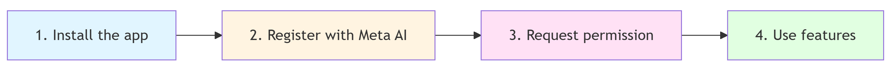

# Meta Wearables: Permissions and Registration (Technical Reference)

**Updated:** Nov 14, 2025

## Overview

DAT separates app registration and device permissions. All permission grants happen through the Meta AI companion app. Permissions work across multiple linked wearables.

Camera permissions are granted at the app level. However, each device will need to confirm permission specifically. This allows your app to support a set of devices with individual permissions.

For creating an integration, see **Build your first integration for Android** or **Build your first integration for iOS**.

---

## Registration

Your app registers with the Meta AI app to be an permitted integration. This establishes the connection between your app and the glasses platform.

*   Registration happens once through Meta AI app with glasses connected.
*   Users see your app name in the list of connected apps.
*   They can unregister anytime through the Meta AI app.
*   You can also implement an unregistration flow is desired.

---

## Device Permissions

After registration, request specific capabilities (limited to `Permission.CAMERA`). The Meta AI app runs the permission grant flow. Users choose **Allow once** (temporary) or **Allow always** (persistent).

### User Experience Flow

1.  **Without registration**, permission requests fail.
2.  **With registration but no permissions**, your app connects but cannot access camera.

---

## Multi-Device Permission Behavior

Users can link multiple glasses to Meta AI. The toolkit handles this transparently.

### How it Works

Users can have multiple pairs of glasses. Permission granted on any linked device allows your app to use that feature. When checking permissions, Wearables Device Access Toolkit queries all connected devices. If **any** device has the permission granted, your app receives "granted" status.

### Practical Implications

| Condition | Result |
| :--- | :--- |
| **One device approved** | Permission checks return **granted**. |
| **All devices disconnected** | Permission checks indicate **unavailability**. |
| **Tracking** | You don't track which specific device has permissions; the SDK abstracts this. |

> [!NOTE]
> Users manage permissions per device in the Meta AI app.

---

## Distribution and Registration

Testing vs production have different permission requirements.

*   **Developer Mode**: Registration is always allowed.
*   **Distribution**: Users must be in the proper release channel to get the app. This is controlled by the MWDAT application ID.

For setting up developer mode, see **Getting started with the Wearables Device Access Toolkit**.

For details on creating release channels, see **Manage projects in Developer Center**.

> [!IMPORTANT]
> This page also explains where to find the `APPLICATION_ID` that must be added to your production manifest/bundle configuration.